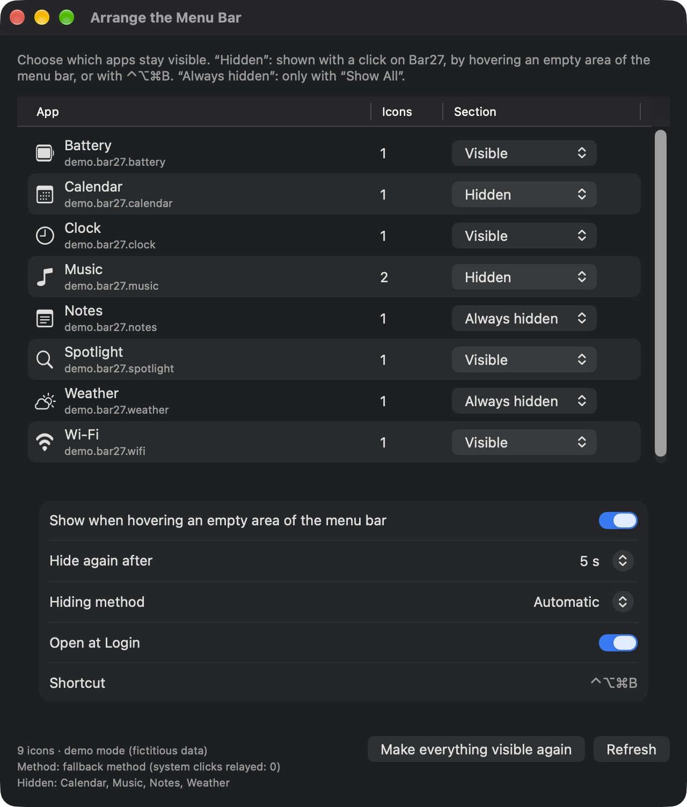

<p align="center"></p>

<h1 align="center">Bar27</h1>

<p align="center">
  An open-source menu bar manager for <b>macOS 27</b>.<br>
  Hide the icons you don't need, bring them back in one click.
</p>

<p align="center">
  <a href="LICENSE"></a>
  
  
</p>

🇫🇷 [Version française](README.fr.md)

## Why Bar27?

macOS 27 hides menu bar items **per application** and lays out the icons itself, so the
classic "drag icons around" approach no longer works. Bar27 is built for that model: it
decides, app by app, what stays visible and what gets tucked away, and it doesn't fight the
system's own ordering.

## Features

- **One-click toggle**: click the Bar27 icon to hide or show every app filed under *Hidden*.
- **Three states per app**: *Visible*, *Hidden* or *Always hidden*, set in the **Arrange the bar** window.
- **Reveal on demand**: click the icon, hover an empty area of the menu bar, or press <kbd>⌃⌥⌘B</kbd>.
- **Auto re-hide** with an adjustable delay.
- **Right-click menu**: Show all, Arrange the bar…, Quit.
- **Native hiding first**: uses the system's own per-app switch when Full Disk Access is granted, and falls back to the "assessment mode" assertion otherwise.
- **English and French**, following the system language.
- Open source, no telemetry.



## Installation

Bar27 is not on a package manager yet. Build it from source:

```sh
brew install xcodegen
git clone https://github.com/ATTILA-KRB/bar27.git
cd bar27
scripts/install.sh   # Release build, signed with your Developer ID, copied to /Applications
```

Requirements:

- macOS 27 and Xcode with the macOS 27 SDK
- [XcodeGen](https://github.com/yonaskolb/XcodeGen)
- A **Developer ID** certificate: MenuBarAgent only honours the hiding assertion for apps signed with Developer ID.

Then grant **Full Disk Access** to `/Applications/Bar27.app` (System Settings → Privacy & Security) so Bar27 can use the native switch. Without it, it falls back to the assertion.

## Usage

1. On first launch the **Arrange the bar** window opens. File each app as Visible, Hidden or Always hidden.
2. Click the Bar27 icon to reveal or hide the Hidden group.
3. Lost the icon? Double-click Bar27 in `/Applications`; the window reopens.

## FAQ

**Does Bar27 reorder my icons?**
No. macOS 27 manages the order itself; Bar27 only chooses what is hidden.

**Why do I need a Developer ID certificate?**
The system agent that manages the menu bar only honours the assertion Bar27 relies on for Developer ID–signed apps.

**Can I hide Spotlight or other system items?**
There is an option for it. The assertion only covers items the native switch does not track.

**Does it work on macOS 26 or earlier?**
No, it targets macOS 27 and its per-app model.

## Development

```sh
scripts/test.sh                 # core tests + signed build + accessibility inventory
scripts/build.sh                # build/Bar27.app (Debug, Developer ID signed)
scripts/verify-conceal.sh <id>  # hide an app for 3 s, screenshots in build/verify/
swift scripts/make-icon.swift   # regenerate the icon (AppIcon.appiconset + docs/logo.png)
```

Notarisation: `scripts/notarize.sh` (App Store Connect API key via `ASC_KEY_PATH`, `ASC_KEY_ID`, `ASC_ISSUER_ID`, in the environment or in the git-ignored `scripts/notarize.local.env`). `scripts/deploy-local.sh` notarises, then installs.

More: [`docs/PLAN.md`](docs/PLAN.md) (plan), [`docs/SPIKES.md`](docs/SPIKES.md) (measurements). Contributions are welcome.

## Credits

The "assessment mode" hiding assertion is adapted from [Ice](https://github.com/jordanbaird/Ice) (PR #995), [Barometer](https://github.com/mackid1993/Barometer) and [Thaw](https://github.com/thaw-app/Thaw), all GPLv3.

## License

[GPLv3](LICENSE)
